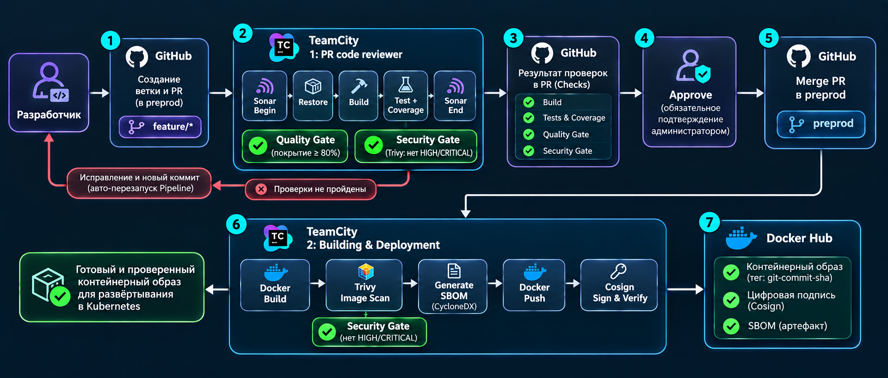

# CI/CD Pipeline с TeamCity, GitHub, SonarQube, Trivy, Docker и Cosign

## О проекте

<p align="center">
  
</p>

Этот проект представляет собой практический пример построения автоматизированного CI/CD-процесса для .NET-приложения с использованием инструментов контроля качества кода, анализа безопасности и цифровой подписи Docker-образов.

Основная цель — организовать процесс разработки, при котором каждое изменение исходного кода проходит обязательные проверки перед объединением с защищёнными ветками, а Docker-образы собираются и публикуются только после успешного завершения проверок.

Для этого используются следующие инструменты:

- **GitHub** — хранение исходного кода, управление ветками и Pull Requests.
- **TeamCity** — автоматизация сборки, тестирования и публикации Docker-образов.
- **SonarQube** — статический анализ исходного кода и контроль Quality Gate.
- **Trivy** — сканирование исходного проекта и Docker-образов на уязвимости.
- **Docker** — сборка контейнерных образов приложения.
- **Docker Hub** — хранение и распространение Docker-образов.
- **CycloneDX SBOM** — формирование перечня компонентов и зависимостей Docker-образа.
- **Cosign** — цифровая подпись Docker-образов и проверка их целостности.

Процесс разделён на два Pipeline:

1. **PR Code Reviewer** — выполняет сборку и тестирование приложения, анализирует покрытие кода, проверяет качество через SonarQube и сканирует проект с помощью Trivy.
2. **Building & Deployment** — собирает Docker-образ, проверяет его безопасность, формирует SBOM, публикует образ в Docker Hub и подписывает его с помощью Cosign.

Второй Pipeline запускается автоматически после успешного завершения первого для ветки `preprod`.

Представленную конфигурацию можно использовать как основу для построения CI/CD в других проектах, адаптируя её под используемые технологии и требования безопасности.

---

## 1. Используемые инструменты и зависимости

В этом разделе перечислены инструменты, необходимые для работы CI/CD, и их назначение.

### 1.1. TeamCity Server

| Инструмент | Назначение |
|---|---|
| TeamCity | Управление Pipeline, настройка Build Configurations, запуск и контроль сборок |
| OpenJDK | Среда выполнения Java для TeamCity |
| PostgreSQL | Хранение конфигурации, истории сборок и других данных TeamCity |
| PostgreSQL JDBC Driver | Подключение TeamCity к PostgreSQL |

### 1.2. TeamCity Build Agent

На Build Agent выполняются основные операции CI/CD: компиляция приложения, тестирование, анализ кода, сборка и публикация Docker-образов.

| Инструмент | Назначение |
|---|---|
| OpenJDK | Работа TeamCity Build Agent |
| Git | Получение исходного кода из GitHub |
| .NET SDK | Сборка и тестирование .NET-приложения |
| SonarScanner for .NET | Анализ исходного кода и передача результатов в SonarQube |
| ReportGenerator | Формирование HTML-отчётов о покрытии кода тестами |
| Trivy | Проверка файлов проекта и Docker-образов на уязвимости |
| Docker Engine | Сборка и локальная работа с контейнерными образами |
| Docker Buildx | Расширенные возможности сборки Docker-образов |
| Cosign | Цифровая подпись Docker-образов и проверка подписей |
| Python 3 | Обработка JSON-отчётов и SBOM в скриптах Pipeline |

### 1.3. SonarQube Server

| Инструмент | Назначение |
|---|---|
| SonarQube | Статический анализ исходного кода и контроль Quality Gate |
| PostgreSQL | Хранение результатов анализа и данных SonarQube |
| Java Runtime | Работа компонентов SonarQube, использующих Java |

### 1.4. Внешние сервисы

| Сервис | Назначение |
|---|---|
| GitHub | Хранение исходного кода, работа с Pull Requests и защита веток |
| Docker Hub | Хранение Docker-образов и связанных с ними цифровых подписей |
| Sigstore | Инфраструктура и форматы цифровых подписей, используемые Cosign |

### 1.5. Зависимости .NET-проекта

| Пакет | Назначение |
|---|---|
| xUnit | Написание и выполнение автоматизированных тестов |
| Microsoft.AspNetCore.Mvc.Testing | Интеграционное тестирование ASP.NET Core API |
| coverlet.collector | Сбор данных о покрытии кода тестами |
| Microsoft.AspNetCore.OpenApi | Поддержка OpenAPI в приложении |

Конкретные версии NuGet-пакетов определяются файлами `.csproj` проекта.

---
<a name="git-workflow"></a>
## 2. Настройка GitHub

### 2.1. Организация репозитория и веток

Для хранения исходного кода и управления изменениями используется GitHub.

Репозиторий проекта: [mdv-devops/cicd-lab](https://github.com/mdv-devops/cicd-lab).

В репозитории используются три типа веток:

| Ветка | Назначение |
|---|---|
| `main` | Основная защищённая ветка проекта. Изменения в неё переносятся через Pull Request из `preprod`. |
| `preprod` | Защищённая ветка, в которой объединяются и проверяются изменения разработчиков перед переносом в `main`. |
| `feature/*` | Рабочие ветки разработчиков, предназначенные для новых функций, исправлений и других изменений. |

Ветка `main` установлена в GitHub как ветка по умолчанию.

### 2.2. Порядок внесения изменений

**Шаг 1. Создание рабочей ветки**

Разработчик создаёт новую ветку от `preprod`, например `feature/add-endpoint`.

Все изменения выполняются в этой ветке, без прямого изменения `preprod` или `main`.

**Шаг 2. Создание Pull Request в `preprod`**

После завершения работы разработчик отправляет изменения в GitHub и создаёт Pull Request из своей рабочей ветки в `preprod`.

Для объединения изменений необходимо:

- Успешно пройти настроенные автоматические проверки.
- Получить обязательное одобрение Pull Request по результатам проверки (Teamcity Approve).

**Шаг 3. Объединение изменений в `preprod`**

После выполнения всех требований Pull Request можно объединить с `preprod`.

- Получить обязательное одобрение Pull Request от teamleader (Manual Approve (Не возможно без Teamcity Approve))

На этом этапе изменения становятся частью общей интеграционной ветки.

**Шаг 4. Создание Pull Request в `main`**

После проверки изменений в `preprod` создаётся отдельный Pull Request из `preprod` в `main`.

Объединение выполняется с соблюдением правил защиты основной ветки.

Прямое внесение изменений в `main` и `preprod` запрещено.

### 2.3. Схема работы с ветками

```text
feature/add-endpoint ── Pull Request ──┐
                                      │
feature/fix-bug ─────── Pull Request ──┤
                                      │
                                      ▼
                              Quality & Security
                                    Gates
                                      │
                              PR Code Reviewer
                                      │
                                      ▼
                                   preprod
                                      │
                                      ▼
                             Building & Deployment
                                      │
                                      ▼
                                Pull Request
                                      │
                                      ▼
                                     main
```

Такая схема позволяет разделить повседневную разработку, интеграцию изменений и подготовку основной версии приложения.

Изменения проходят автоматизированные проверки до попадания в `preprod`, а контейнерный образ собирается только из ревизии исходного кода, успешно прошедшей проверки.

Перенос изменений в `main` выполняется через отдельный Pull Request.

Такая схема позволяет разделить повседневную разработку и основную ветку проекта.

Изменения сначала проходят проверку и согласование в `preprod`, а затем переносятся в `main` через отдельный Pull Request.

### 2.4. Защита ветки `preprod`

Для защиты интеграционной ветки используются GitHub Rulesets.

Основные механизмы защиты:

- Запрет прямого внесения изменений.
- Обязательное создание Pull Request.
- Обязательное успешное прохождение проверок TeamCity.
- Контроль ручных одобрений согласно настройкам Ruleset.
- Обязательное завершение обсуждений.
- Запрет удаления ветки.
- Запрет принудительной перезаписи истории.

GitHub использует результат выполнения Pipeline `1: PR code reviewer` для определения возможности объединения Pull Request.

**Техническая документация:**

- [Создание и настройка Ruleset](docs/github.md#preprod-protection)
- [Настройка обязательного Pull Request](docs/github.md#pull-request-rules)
- [Настройка обязательных проверок TeamCity](docs/github.md#required-status-checks)

### 2.5. Защита ветки `main`

Ветка `main` предназначена для хранения основной версии приложения.

Настройка правил защиты этой ветки будет завершена после реализации автоматизированного развёртывания приложения в Kubernetes и проверок после развёртывания.

**Техническая документация:**

- [Настройка защиты ветки main](docs/github.md#main-protection)

---

<a name="teamcity-configuration"></a>

## 3. Настройка TeamCity

TeamCity является центральным компонентом CI/CD Pipeline и отвечает за автоматизацию процессов проверки качества и безопасности исходного кода, сборки и публикации контейнерных образов.

### 3.1. Организация проекта

В TeamCity используется единый проект `global`, внутри которого настроены две Build Configurations:

| Build Configuration | Назначение |
|---|---|
| `1: PR code reviewer` | Сборка приложения, тестирование, анализ качества кода и сканирование зависимостей |
| `2: Building & Deployment` | Сборка Docker-образа, сканирование, формирование SBOM, публикация и цифровая подпись |

**Техническая документация:**

- [Создание проекта TeamCity](docs/teamcity.md#project-creation)

### 3.2. Подключение GitHub

Для интеграции TeamCity с GitHub используются VCS Roots, обеспечивающие получение исходного кода и отслеживание изменений в репозитории.

Для аутентификации используется GitHub Personal Access Token (PAT).

Основной веткой для выполнения CI/CD Pipeline является `preprod`.

**Техническая документация:**

- [Настройка VCS Root](docs/teamcity.md#vcs-root)
- [Настройка аутентификации](docs/teamcity.md#vcs-authentication)
- [Проверка подключения](docs/teamcity.md#test-vcs-connection)

---

<a name="pr-code-reviewer"></a>

## 4. Pipeline 1 — PR Code Reviewer

Первый Pipeline предназначен для автоматизированного контроля качества и безопасности исходного кода перед объединением изменений в ветку `preprod`.

Pipeline запускается автоматически при создании или обновлении Pull Request, а также при изменениях в ветке `preprod`.

### 4.1. Интеграция с GitHub

Для взаимодействия TeamCity с GitHub используются следующие механизмы:

| Компонент | Назначение |
|---|---|
| VCS Root | Получение исходного кода из репозитория |
| Pull Requests Build Feature | Обнаружение Pull Requests |
| VCS Trigger | Автоматический запуск проверок |
| Commit Status Publisher | Публикация результатов проверок в GitHub |

**Техническая документация:**

- [Создание Build Configuration](docs/pr-code-reviewer.md#create-build-configuration)
- [Подключение VCS Root](docs/pr-code-reviewer.md#vcs-root)
- [Настройка Pull Requests Build Feature](docs/pr-code-reviewer.md#pull-requests)
- [Настройка Build Triggers](docs/pr-code-reviewer.md#build-triggers)
- [Настройка Commit Status Publisher](docs/pr-code-reviewer.md#commit-status-publisher)

### 4.2. Последовательность выполнения Pipeline

Pipeline состоит из семи последовательных Build Steps:

```text
SonarScanner Begin
        │
        ▼
     Restore
        │
        ▼
      Build
        │
        ▼
      Test
        │
        ▼
 SonarScanner End
        │
        ▼
 Coverage Report
        │
        ▼
Trivy Dependency Scan
```

| Build Step | Назначение |
|---|---|
| [SonarScanner Begin](docs/pr-code-reviewer.md#sonarscanner-begin) | Инициализация анализа исходного кода |
| [Restore](docs/pr-code-reviewer.md#restore) | Восстановление NuGet-зависимостей |
| [Build](docs/pr-code-reviewer.md#build) | Компиляция приложения |
| [Test](docs/pr-code-reviewer.md#test) | Выполнение тестов и сбор данных о покрытии |
| [SonarScanner End](docs/pr-code-reviewer.md#sonarscanner-end) | Завершение анализа и проверка Quality Gate |
| [Coverage Report](docs/pr-code-reviewer.md#coverage-report) | Формирование HTML-отчёта о покрытии кода |
| [Trivy Dependency Scan](docs/pr-code-reviewer.md#trivy-dependency-scan) | Сканирование зависимостей на уязвимости |

### 4.3. Quality & Security Gates

Первый Pipeline обеспечивает контроль качества и безопасности исходного кода на нескольких уровнях.

**Build Gate**

Приложение должно успешно компилироваться.

**Test Gate**

Все автоматизированные тесты должны завершиться успешно.

**SonarQube Quality Gate**

Исходный код должен соответствовать установленным требованиям качества:

- Покрытие нового кода тестами — не менее 80%.
- Отсутствие новых проблем высокой и более критичной степени серьёзности.
- Дублирование нового кода — не более 3%.

**Trivy Security Gate**

В зависимостях приложения не должны присутствовать известные уязвимости следующих уровней критичности:

- HIGH
- CRITICAL

При нарушении обязательных требований Pipeline завершается с ошибкой.

Результат проверки публикуется в GitHub, где используется правилами защиты ветки `preprod` для блокировки объединения Pull Request.

### 4.4. Отчёты и результаты проверок

Для анализа результатов выполнения Pipeline используются отчёты TeamCity и SonarQube.

| Отчёт | Назначение |
|---|---|
| Tests | Результаты автоматизированных тестов |
| Coverage Report | Детализированный HTML-отчёт о покрытии кода |
| Trivy Report | HTML-отчёт об обнаруженных уязвимостях |
| Artifacts | Опубликованные файлы отчётов |
| SonarQube | Результаты анализа качества и безопасности исходного кода |

Отчёты позволяют разработчику определить причины неуспешного выполнения Pipeline и устранить обнаруженные проблемы.

**Техническая документация:**

- [Настройка Build Report Tabs](docs/pr-code-reviewer.md#build-report-tabs)
- [Проверка работы Pipeline](docs/pr-code-reviewer.md#pipeline-verification)

### 4.5. Результат выполнения Pipeline

При успешном прохождении обязательных проверок Pull Request может быть объединён с веткой `preprod` при выполнении остальных требований GitHub Ruleset.

После объединения изменений TeamCity повторно выполняет проверки для ветки `preprod`.

Успешное завершение этой сборки является условием автоматического запуска второго Pipeline — Building & Deployment.

---

# === 2: Building & Deployment ===

## 4. Настройка Building & Deployment

Pipeline `2: Building & Deployment` предназначен для автоматизации сборки контейнерного образа приложения, проверки его безопасности, формирования SBOM, публикации в контейнерном реестре и цифрового подписания.

Pipeline автоматически запускается после успешного слияния Pull Request в ветку `preprod` и прохождения проверок обновлённой ветки.

### 4.1. Создание Build Configuration

**Шаг 1. Добавление Build Configuration**

Перейдите в `Administration → Projects → global`.

Нажмите `Create build configuration` и выберите `Manually`.

**Шаг 2. Настройка параметров**

| Параметр | Значение |
|---|---|
| Name | `2: Building & Deployment` |
| Build configuration type | `Regular` |

Остальные параметры оставьте по умолчанию.

**Шаг 3. Сохранение**

Нажмите `Create`.

### 4.2. Подключение VCS Root

Для Pipeline `2: Building & Deployment` создадим отдельный VCS Root, который будет отслеживать изменения только в ветке `preprod`.

**Шаг 1. Создание VCS Root**

Перейдите в `Administration → Projects → global → VCS Roots`.

Нажмите `Create VCS root` и выберите тип `Git`.

**Шаг 2. Настройка параметров**

| Параметр | Значение |
|---|---|
| VCS root name | `Building & Development vcs` |
| VCS root ID | `Global_BuildingDevelopmentVcs` |
| Fetch URL | `https://github.com/mdv-devops/cicd-lab.git` |
| Default branch | `refs/heads/preprod` |
| Branch specification | Оставить пустым |
| Authentication method | `Password / personal access token` |
| Username | `Teamcity` |
| Password / access token | GitHub Personal Access Token |

Поле `Branch specification` оставляем пустым, поскольку Pipeline должен работать только с веткой `preprod`.

**Шаг 3. Проверка подключения**

Нажмите `Test connection` и убедитесь, что TeamCity успешно подключается к GitHub-репозиторию.

Нажмите `Save`.

**Шаг 4. Подключение VCS Root к Build Configuration**

1. Перейдите в `global → 2: Building & Deployment → Version Control`.
2. Нажмите `Attach VCS root`.
3. Выберите созданный `Building & Development vcs`.
4. Сохраните изменения.

Остальные параметры оставьте по умолчанию.

Таким образом, исходный код для сборки контейнерного образа будет загружаться из ветки `preprod`.

### 4.3. Настройка подключения к Docker Hub

Для публикации контейнерных образов необходимо настроить подключение TeamCity к контейнерному реестру.

В данном проекте используется Docker Hub, однако аналогичным образом можно настроить подключение к другому совместимому контейнерному реестру.

**Шаг 1. Создание подключения к контейнерному реестру**

Перейдите в `Administration → Projects → global → Connections`.

Нажмите `Add Connection` и выберите `Docker Registry`.

Укажите адрес контейнерного реестра, имя пользователя и токен доступа с необходимыми правами для загрузки и публикации контейнерных образов.

Сохраните подключение.

**Шаг 2. Добавление Build Feature**

Перейдите в `global → 2: Building & Deployment → Build Features`.

Нажмите `Add build feature` и выберите `Docker Registry Connections`.

Нажмите `Add registry connection` и выберите ранее созданное подключение к контейнерному реестру.

Параметр `On server clean-up, delete pushed Docker images from registry` оставьте отключённым, чтобы при автоматической очистке истории сборок TeamCity не удалял опубликованные контейнерные образы из реестра.

Нажмите `Save`.

**Как работает Docker Registry Connections**

Перед запуском сборки TeamCity автоматически выполняет аутентификацию в указанном контейнерном реестре.

Это позволяет:

- Загружать базовые контейнерные образы.
- Публиковать собранные контейнерные образы.
- Выполнять операции подписания образов с помощью Cosign.
- Отслеживать опубликованные контейнерные образы через отдельную вкладку в интерфейсе сборки.

При таком подходе нет необходимости добавлять команду `docker login` в Build Steps или хранить учётные данные непосредственно в скриптах Pipeline.

### 4.4. Настройка Build Trigger

Для автоматического запуска Pipeline `2: Building & Deployment` используется **Finish Build Trigger**.

Pipeline должен запускаться только после слияния Pull Request в ветку `preprod` и успешного завершения проверки обновлённой ветки в `1: PR code reviewer`.

### 4.4. Настройка Snapshot Dependency

Для обеспечения согласованности Git-ревизий между Pipeline необходимо настроить **Snapshot Dependency**.

Это позволяет собирать контейнерный образ из той же ревизии исходного кода, которая успешно прошла проверки качества и безопасности в `1: PR code reviewer`.

**Шаг 1. Добавление Snapshot Dependency**

Перейдите в `global → 2: Building & Deployment → Dependencies`.

Нажмите `Add new snapshot dependency` и выберите `1: PR code reviewer`.

**Шаг 2. Настройка параметров**

| Параметр | Значение |
|---|---|
| Enforce revisions synchronization | Включено |
| Do not run new build if there is a suitable one | Включено |
| Only use successful builds from suitable ones | Включено |
| Run build on the same agent | Отключено |
| On failed dependency | `Cancel build` |
| On failed to start/canceled dependency | `Mark build as failed to start` |

**Назначение основных параметров:**

- `Enforce revisions synchronization` — обеспечивает синхронизацию ревизий исходного кода между сборками.
- `Do not run new build if there is a suitable one` — позволяет повторно использовать подходящую сборку без повторного выполнения проверок.
- `Only use successful builds from suitable ones` — разрешает повторное использование только успешных сборок.
- `On failed dependency: Cancel build` — предотвращает выполнение Pipeline при неуспешном завершении зависимой сборки.
- `On failed to start/canceled dependency: Mark build as failed to start` — предотвращает запуск Pipeline, если зависимая сборка была отменена или не смогла запуститься.

**Шаг 3. Сохранение**

Нажмите `Save`.

После сохранения обе Build Configurations будут объединены в единую **Build Chain**.

Настроенная зависимость обеспечивает согласованность Git-ревизий между Pipeline, гарантируя, что контейнерный образ будет собран именно из той ревизии исходного кода, которая успешно прошла проверки качества и безопасности.

### 4.5. Настройка Build Trigger

Для автоматического запуска Pipeline `2: Building & Deployment` используется **Finish Build Trigger**.

Pipeline должен запускаться после слияния Pull Request в ветку `preprod` и успешного завершения проверки обновлённой ветки в `1: PR code reviewer`.

**Шаг 1. Добавление Build Trigger**

Перейдите в `global → 2: Building & Deployment → Triggers`.

Нажмите `Add new trigger` и выберите `Finish Build Trigger`.

**Шаг 2. Настройка параметров**

| Параметр | Значение |
|---|---|
| Build configuration | `global / 1: PR code reviewer` |
| Trigger after successful build only | Включено |
| Branch filter | `+:<default>` |

Остальные параметры оставьте по умолчанию.

Параметр `Trigger after successful build only` разрешает автоматический запуск Pipeline только после успешного завершения указанной Build Configuration.

Фильтр `+:<default>` ограничивает срабатывание триггера сборками ветки `preprod`, исключая запуск Pipeline после проверки открытых Pull Requests.

**Шаг 3. Сохранение**

Нажмите `Save`.

**Последовательность запуска Pipeline**

1. Разработчик создаёт Pull Request в ветку `preprod`.
2. TeamCity запускает `1: PR code reviewer` для проверки Pull Request.
3. После успешного прохождения обязательных проверок Pull Request сливается в `preprod`.
4. TeamCity запускает `1: PR code reviewer` для проверки обновлённой ветки `preprod`.
5. После успешного завершения проверки автоматически запускается `2: Building & Deployment`.

Настроенный Finish Build Trigger определяет условия автоматического запуска Pipeline, а ранее настроенная Snapshot Dependency обеспечивает согласованность Git-ревизий между сборками.

Таким образом, сборка контейнерного образа выполняется из проверенной ревизии исходного кода ветки `preprod`.

### 4.6. Настройка Build Steps

Перейдите в `global → 2: Building & Deployment → Build Steps`.

#### 4.6.1. Build

На этом этапе выполняется сборка контейнерного образа приложения на основе `Dockerfile`, расположенного в корневом каталоге GitHub-репозитория.

**Шаг 1. Добавление Build Step**

Нажмите `Add build step` и выберите `Docker`.

**Шаг 2. Настройка параметров**

| Параметр | Значение |
|---|---|
| Step name | `Build` |
| Docker command | `build` |
| Dockerfile source | `File` |
| Dockerfile path | `Dockerfile` |
| Context folder | `.` |
| Image name:tag | `%IMAGE_NAME%:%build.vcs.number%` |
| Additional arguments | `--pull` |

Остальные параметры оставьте по умолчанию.

Аргумент `--pull` позволяет Docker проверять наличие более свежих версий базовых образов в контейнерном реестре при каждой сборке.

**Шаг 3. Настройка имени контейнерного образа**

В разделе `Parameters` создайте конфигурационный параметр:

| Параметр | Значение |
|---|---|
| Name | `IMAGE_NAME` |
| Kind | `Configuration parameter` |
| Value | `<docker-user>/<docker-repo>` |

Где:

- `<docker-user>` — имя пользователя или организации в Docker Hub.
- `<docker-repo>` — имя репозитория контейнерных образов.

Вынесение имени образа в отдельный параметр позволяет использовать его во всех последующих Build Steps без дублирования настроек.

**Формирование тега контейнерного образа**

В качестве тега используется Git commit SHA, получаемый через встроенный параметр TeamCity:

```text
%build.vcs.number%
```

Полное имя контейнерного образа формируется следующим образом:

```text
%IMAGE_NAME%:%build.vcs.number%
```

Использование Git commit SHA в качестве тега позволяет:

- Связать контейнерный образ с конкретной ревизией исходного кода.
- Обеспечить прослеживаемость между GitHub, TeamCity и контейнерным реестром.
- Идентифицировать версию приложения при развёртывании.
- Упростить выбор предыдущей версии приложения при необходимости отката.

**Шаг 4. Сохранение**

Нажмите `Save`.

После успешного выполнения шага контейнерный образ будет доступен локально на Build Agent для последующего сканирования, формирования SBOM и публикации в контейнерном реестре.

#### 4.6.2. Trivy Image Scan

На этом этапе выполняется сканирование собранного контейнерного образа с помощью Trivy перед его публикацией в Docker Hub.

Сканирование включает:

- **Vulnerabilities** — известные уязвимости в системных пакетах и зависимостях приложения.
- **Secrets** — потенциально конфиденциальные данные, содержащиеся в образе.
- **Misconfigurations** — небезопасные конфигурации, обнаруженные в поддерживаемых Trivy файлах.

**Шаг 1. Добавление Build Step**

Нажмите `Add build step` и выберите `Command Line`.

**Шаг 2. Настройка параметров**

| Параметр | Значение |
|---|---|
| Step name | `Trivy Image Scan` |
| Run | `Custom script` |

В поле `Custom script` добавьте следующий скрипт:

```bash
#!/usr/bin/env bash
set -euo pipefail

IMAGE="%IMAGE_NAME%:%build.vcs.number%"
REPORT_DIR="trivy-report"

mkdir -p "$REPORT_DIR"

echo "=== Generating Trivy JSON Report ==="

trivy image --scanners vuln,secret,misconfig --severity UNKNOWN,LOW,MEDIUM,HIGH,CRITICAL --format json --output "$REPORT_DIR/trivy-report.json" --exit-code 0 "$IMAGE"

echo "=== Generating Trivy HTML Report ==="

trivy convert --format template --template "@/usr/local/share/trivy/templates/html.tpl" --output "$REPORT_DIR/index.html" "$REPORT_DIR/trivy-report.json"

echo "=== Security Gate ==="

trivy image --scanners vuln --severity HIGH,CRITICAL --exit-code 1 "$IMAGE"

echo "Security Gate PASSED"
```

**Принцип работы скрипта**

Сканирование выполняется в несколько этапов:

1. **Генерация JSON-отчёта** — сканирование контейнерного образа на наличие уязвимостей, секретов и ошибок конфигурации. В отчёт включаются результаты всех уровней критичности.
2. **Генерация HTML-отчёта** — преобразование JSON-отчёта в HTML с помощью шаблона Trivy для последующего просмотра результатов в интерфейсе TeamCity.
3. **Security Gate** — проверка контейнерного образа на наличие уязвимостей уровней `HIGH` и `CRITICAL`.

**Условия прохождения Security Gate**

| Уровень критичности уязвимости | Результат |
|---|---|
| UNKNOWN | PASSED |
| LOW | PASSED |
| MEDIUM | PASSED |
| HIGH | FAILED |
| CRITICAL | FAILED |

При обнаружении хотя бы одной уязвимости уровня `HIGH` или `CRITICAL` Trivy завершает работу с кодом возврата `1`, что приводит к неуспешному завершению сборки и предотвращает выполнение последующих шагов Pipeline.

Обнаруженные секреты и ошибки конфигурации включаются в отчёт, но в рамках текущей конфигурации не являются блокирующими условиями Security Gate.

Отчёты формируются до выполнения Security Gate, что позволяет сохранить результаты сканирования даже при неуспешном завершении проверки.

**Шаг 3. Сохранение**

Нажмите `Save`.

**Шаг 4. Настройка публикации отчётов**

Перейдите в `global → 2: Building & Deployment → General Settings`.

В поле `Artifact paths` добавьте:

```text
trivy-report/** => trivy-report
```

Для параметра `Publish artifacts` выберите `Even if build fails`.

Это обеспечит доступность отчётов независимо от результата прохождения Security Gate.

После выполнения сборки в разделе `Artifacts` будут доступны следующие файлы:

| Файл | Назначение |
|---|---|
| `trivy-report/trivy-report.json` | Машиночитаемый отчёт сканирования |
| `trivy-report/index.html` | HTML-отчёт для просмотра результатов |

Таким образом, Security Gate предотвращает публикацию контейнерных образов, содержащих обнаруженные уязвимости уровней `HIGH` и `CRITICAL`.

#### 4.6.3. Generate SBOM
---
> **Статус: будет доработан.**
>
> На текущем этапе реализовано формирование SBOM и его сохранение в артефактах TeamCity.
>
> В дальнейшем планируется интеграция с централизованной системой хранения и анализа SBOM для отслеживания программных компонентов, мониторинга вновь обнаруженных уязвимостей и управления рисками цепочки поставок программного обеспечения (Software Supply Chain Security).
---
На этом этапе выполняется формирование **SBOM (Software Bill of Materials)** — перечня программных компонентов, входящих в состав контейнерного образа.

Для генерации SBOM используется Trivy, а результаты сохраняются в стандартизированном формате CycloneDX.

Наличие SBOM позволяет:

- Получить информацию о системных пакетах и зависимостях приложения.
- Отслеживать используемые компоненты и их версии.
- Определять наличие компонентов, в которых впоследствии могут быть обнаружены уязвимости.
- Обеспечить прозрачность состава программного обеспечения.
- Использовать результаты для аудита и анализа безопасности цепочки поставок программного обеспечения (Software Supply Chain Security).

**Шаг 1. Добавление Build Step**

Нажмите `Add build step` и выберите `Command Line`.

**Шаг 2. Настройка параметров**

| Параметр | Значение |
|---|---|
| Step name | `Generate SBOM` |
| Run | `Custom script` |

В поле `Custom script` добавьте следующий скрипт:

```bash
#!/usr/bin/env bash
set -euo pipefail

IMAGE="%IMAGE_NAME%:%build.vcs.number%"
REPORT_DIR="sbom-report"

mkdir -p "$REPORT_DIR"

echo "=== Generating CycloneDX SBOM ==="

trivy image --format cyclonedx --output "$REPORT_DIR/sbom.json" "$IMAGE"

echo "=== SBOM generated ==="

ls -lh "$REPORT_DIR/sbom.json"

echo "=== Number of components ==="

python3 -c 'import json; d=json.load(open("sbom-report/sbom.json")); print("Components:", len(d.get("components", [])))'
```

**Принцип работы скрипта**

1. Определяется имя контейнерного образа с использованием параметров `IMAGE_NAME` и `build.vcs.number`.
2. Создаётся каталог для хранения SBOM.
3. Trivy анализирует контейнерный образ и формирует SBOM в формате CycloneDX JSON.
4. В Build Log выводится информация о сформированном файле и его размере.
5. С помощью Python подсчитывается количество компонентов, включённых в SBOM.

Формирование SBOM выполняется после успешного прохождения Security Gate и до публикации контейнерного образа в Docker Hub.

**Шаг 3. Сохранение**

Нажмите `Save`.

**Шаг 4. Настройка публикации SBOM**

Перейдите в `global → 2: Building & Deployment → General Settings`.

В поле `Artifact paths` добавьте правило публикации SBOM, сохранив ранее настроенное правило публикации отчётов Trivy:

```text
trivy-report/** => trivy-report
sbom-report/** => sbom-report
```

Для параметра `Publish artifacts` оставьте ранее установленное значение `Even if build fails`.

После выполнения данного шага в разделе `Artifacts` будет доступен файл:

| Файл | Назначение |
|---|---|
| `sbom-report/sbom.json` | Перечень программных компонентов в формате CycloneDX JSON |

SBOM сохраняется в артефактах соответствующей сборки TeamCity, обеспечивая возможность анализа состава контейнерного образа для конкретной Git-ревизии.

В отличие от Trivy Image Scan, данный шаг предназначен для инвентаризации программных компонентов и не выполняет дополнительную проверку Security Gate.

#### 4.6.4. Push

На этом этапе выполняется публикация контейнерного образа в Docker Hub после успешного прохождения Security Gate и формирования SBOM.

Для публикации используется ранее настроенное подключение к Docker Hub через `Docker Registry Connections`.

**Шаг 1. Добавление Build Step**

Нажмите `Add build step` и выберите `Docker`.

**Шаг 2. Настройка параметров**

| Параметр | Значение |
|---|---|
| Step name | `Push` |
| Docker command | `push` |
| Image name:tag | `%IMAGE_NAME%:%build.vcs.number%` |

Остальные параметры оставьте по умолчанию.

Для публикации используется то же имя и тег контейнерного образа, которые были определены на этапе `Build`.

Авторизация в Docker Hub выполняется автоматически средствами TeamCity благодаря ранее настроенному Build Feature `Docker Registry Connections`. Дополнительное выполнение команды `docker login` не требуется.

**Шаг 3. Сохранение**

Нажмите `Save`.

После успешного выполнения данного шага контейнерный образ будет доступен в Docker Hub:

```text
docker.io/<docker-user>/<docker-repo>:<git-commit-sha>
```

Публикация выполняется только при успешном завершении предыдущих Build Steps.

#### 4.6.5. Cosign Sign & Verify

На этом этапе выполняется цифровое подписание опубликованного контейнерного образа с помощью Cosign и последующая проверка его подписи.

Использование цифровой подписи позволяет подтвердить подлинность контейнерного образа и обеспечить контроль его целостности в рамках Software Supply Chain Security.

**Шаг 1. Генерация ключей Cosign**

На компьютере с установленным Cosign выполните команду:

```bash
cosign generate-key-pair
```

В процессе генерации необходимо указать пароль для защиты приватного ключа.

В результате будут созданы два файла:

| Файл | Назначение |
|---|---|
| `cosign.key` | Приватный ключ для подписания контейнерных образов |
| `cosign.pub` | Публичный ключ для проверки цифровой подписи |

Приватный ключ и пароль необходимо хранить в защищённом месте. Не допускается их размещение в GitHub-репозитории.

Публичный ключ может распространяться свободно и использоваться внешними системами для проверки подписи контейнерных образов.

**Шаг 2. Настройка параметров TeamCity**

Перейдите в `global → 2: Building & Deployment → Parameters`.

Создайте следующие параметры:

| Name | Type | Value |
|---|---|---|
| `env.COSIGN_PRIVATE_KEY` | Password | Содержимое файла `cosign.key` |
| `env.COSIGN_PUBLIC_KEY` | Text | Содержимое файла `cosign.pub` |
| `env.COSIGN_PASSWORD` | Password | Пароль приватного ключа |

Префикс `env.` обеспечивает передачу параметров в Build Agent в качестве переменных окружения.

Приватный ключ и пароль должны иметь тип `Password`, чтобы ограничить их отображение в интерфейсе TeamCity и Build Log.

**Шаг 3. Добавление Build Step**

Перейдите в `Build Steps`.

Нажмите `Add build step` и выберите `Command Line`.

**Шаг 4. Настройка параметров**

| Параметр | Значение |
|---|---|
| Step name | `Cosign Sign & Verify` |
| Run | `Custom script` |

В поле `Custom script` добавьте следующий скрипт:

```bash
#!/usr/bin/env bash
set -euo pipefail
set +x

IMAGE="docker.io/%IMAGE_NAME%:%build.vcs.number%"
REPOSITORY="docker.io/%IMAGE_NAME%"

KEY_DIR="$(mktemp -d)"
chmod 700 "$KEY_DIR"

trap 'rm -rf "$KEY_DIR"' EXIT

printf '%s\n' "$COSIGN_PRIVATE_KEY" > "$KEY_DIR/cosign.key"
printf '%s\n' "$COSIGN_PUBLIC_KEY" > "$KEY_DIR/cosign.pub"

chmod 600 "$KEY_DIR/cosign.key"
chmod 644 "$KEY_DIR/cosign.pub"

echo "=== Resolving Docker image digest ==="

DIGEST="$(docker buildx imagetools inspect "$IMAGE" --format '{{.Manifest.Digest}}')"

if [[ ! "$DIGEST" =~ ^sha256:[a-f0-9]{64}$ ]]; then
    echo "ERROR: Invalid image digest: $DIGEST"
    exit 1
fi

IMAGE_REF="${REPOSITORY}@${DIGEST}"

echo "Image: $IMAGE_REF"

echo "=== Signing Docker image ==="

cosign sign --yes --key "$KEY_DIR/cosign.key" "$IMAGE_REF"

echo "=== Verifying Docker image signature ==="

cosign verify --key "$KEY_DIR/cosign.pub" "$IMAGE_REF"

echo "=== Signature verification successful ==="
```

**Принцип работы скрипта**

1. Создаётся временный каталог с ограниченными правами доступа.
2. Приватный и публичный ключи записываются во временные файлы из переменных окружения TeamCity.
3. С помощью Docker Buildx определяется digest опубликованного контейнерного образа.
4. Проверяется корректность формата полученного digest.
5. Выполняется подписание контейнерного образа приватным ключом Cosign.
6. Выполняется проверка цифровой подписи публичным ключом.
7. При завершении скрипта временный каталог с ключами автоматически удаляется.

**Подписание контейнерного образа по digest**

В отличие от тега контейнерного образа, который может быть перезаписан, digest является идентификатором конкретного содержимого образа.

Поэтому подписание выполняется не по тегу:

```text
docker.io/<docker-user>/<docker-repo>:<git-commit-sha>
```

а по digest:

```text
docker.io/<docker-user>/<docker-repo>@sha256:<digest>
```

Это обеспечивает привязку цифровой подписи к конкретному опубликованному образу независимо от последующих изменений тегов в контейнерном реестре.

**Безопасность хранения ключей**

В рамках текущей конфигурации предусмотрены следующие меры защиты:

- Хранение приватного ключа и пароля в защищённых параметрах TeamCity.
- Отключение трассировки команд с помощью `set +x`.
- Использование временного каталога с правами доступа `700`.
- Ограничение прав доступа к приватному ключу до `600`.
- Автоматическое удаление временных файлов при завершении скрипта.

**Шаг 5. Сохранение**

Нажмите `Save`.

При успешном выполнении данного шага в Build Log будет отображено сообщение:

```text
=== Signature verification successful ===
```

При возникновении ошибки получения digest, подписания или проверки цифровой подписи Pipeline завершится со статусом `FAILED`.

При этом необходимо учитывать, что контейнерный образ публикуется на предыдущем этапе `Push`. Ошибка подписания не приводит к автоматическому удалению уже опубликованного образа из Docker Hub.

Для предотвращения использования неподписанных контейнерных образов проверка цифровой подписи должна дополнительно выполняться на этапе развёртывания приложения.

---

Документация будет дополняться по мере реализации и практической проверки новых возможностей.